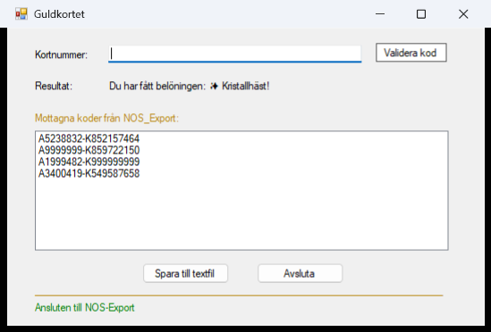
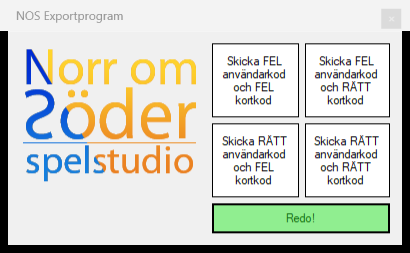
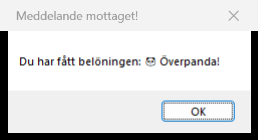

# 🏆 Guldkortet – Windows Forms App

<p align="center">
  
</p>

En Windows Forms-applikation i **C# / .NET Framework 4.8** som delar ut belöningar till spelare.
Programmet är en TCP-server som tar emot kortkoder från ett externt program (**NOS_Export**), kontrollerar kund och kort mot två SQL-databaser och skickar tillbaka vilken belöning spelaren får.
Nätverkstrafiken körs asynkront i bakgrunden så att fönstret aldrig fryser.

---

## 📸 Så ser det ut

| NOS_Export skickar koder | Svaret som NOS_Export får tillbaka |
|---|---|
|  |  |

---

## ✨ Funktionalitet

🔌 **TCP-server**
- Lyssnar på `127.0.0.1:12345` och tar emot koder från NOS_Export
- Status i fönstret: grön när NOS_Export är ansluten, röd när anslutningen bryts

🎴 **Validering av koder**
- Koden har formatet `AnvändarNr-KortNr`, t.ex. `A1234567-K123456789`
- Kontrollerar att kunden finns i `Kundregister` och att kortet finns i `Kortregister`
- Tydligt svar om koden har fel format, kunden saknas eller kortet saknas
- En kod som redan gett en belöning kan inte användas igen

🎁 **Belöningar**
- Fyra belöningar: Dunderkatt, Kristallhäst, Överpanda och Eldtomat
- Byggda med arv och polymorfism: varje belöning är en egen klass som ärver från `Beloning`

📝 **Loggning**
- Alla koder och resultat loggas med tidsstämpel
- Spara till textfil med knappen eller automatiskt när programmet stängs
- Bara nya rader sparas, så inget dubbleras

⌨️ **Manuell kontroll**
- Skriv en kod i fältet **Kortnummer** och klicka **Validera kod**, så körs samma kontroll som för NOS_Export

---

## 🧱 Arkitektur

```
Guldkortet/
├── Program.cs            # Startpunkt
├── Form1.cs              # Fönstret: visar koder, resultat och status
├── TcpKoppling.cs        # TCP-servern: tar emot koder och skickar svar (async/await)
├── GuldkortService.cs    # Logiken: validering, SQL-frågor och val av belöning
├── Model/
│   ├── Beloning.cs       # Basklass för belöningar
│   ├── DunderkattBeloning.cs · KristallhastBeloning.cs
│   ├── OverpandaBeloning.cs · EldtomatBeloning.cs
│   └── Loggpost.cs       # En rad i loggen
├── Kundregister.mdf      # Databas med kunder
├── Kortregister.mdf      # Databas med kort och korttyp
└── NOS_Export.exe        # Testprogrammet som skickar koder
```

- **Separation of concerns:** fönstret (`Form1`) visar, `GuldkortService` bestämmer och `TcpKoppling` sköter nätverket
- **Trådsäkerhet:** nätverket körs i bakgrunden och uppdaterar fönstret via `Invoke`
- **Parametriserade SQL-frågor** skyddar mot SQL-injektion

---

## 🛠️ Kör projektet

Kräver Visual Studio med **.NET Framework 4.8** och **SQL Server LocalDB** (ingår i Visual Studio).

1. Klona projektet och öppna `Guldkortet.slnx` i Visual Studio
2. Starta med **F5** – fönstret visar *Lyssnar på NOS-Export…*
3. Starta `NOS_Export.exe` och klicka **Koppla till server**
4. Klicka på knapparna för att skicka rätt och fel koder

> ⚠️ **Stäng NOS_Export först, sedan Guldkortet.**
> Om Guldkortet stängs först visar NOS_Export tomma meddelanderutor som inte går att stänga.
> Det är ett känt fel i NOS_Export (den kontrollerar inte om anslutningen har stängts), inte i Guldkortet.

---

## 🧪 Tekniker

- C# / .NET Framework 4.8
- Windows Forms
- TCP (`TcpListener`, `NetworkStream`) med async/await
- SQL Server LocalDB med parametriserade frågor
- Objektorienterad programmering (arv och polymorfism)
- Filhantering för loggar

---

## ✍️ Utvecklat av
**Ninnie Dahlström** – kurs *Programmering 2*, NTI
